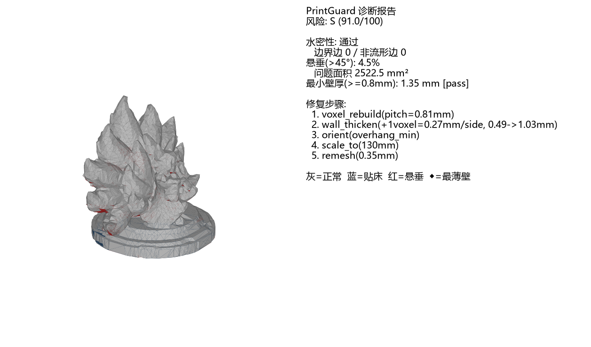

<div align="center">

# 🛡️ PrintGuard_Aholo

**FDM 打印件的「生成 → 体检 → 修复 → 交付」一站式 MCP 服务**

*让 AI 生成的 3D 模型，真正能上打印机。*

[](https://pypi.org/project/PrintGuard-Aholo/)
[](pyproject.toml)
[](LICENSE)
[](https://modelcontextprotocol.io)
[](https://www.modelscope.cn/mcp/servers/miluzzz/PrintGuard_Aholo)

</div>

https://github.com/user-attachments/assets/turntable-preview

## 💡 解决什么问题

AI 文生 3D（Lux3D 等）产出的模型看似精美，直接送 FDM 打印机却常常翻车：

| 痛点 | 后果 | PrintGuard_Aholo 的处理 |
|---|---|---|
| 不水密（壳汤/破面） | 切片直接失败 | 体素重构，输出恒为水密实体 |
| 悬垂超 45° | 拉丝、坍塌、报废 | 悬垂三分类（真悬空/桥接/贴床），区分真问题与误报 |
| 壁厚过薄 | 一掰就碎 | 中轴 EDT 壁厚检测 + 闭环增厚修复 |
| 朝向随意 | 支撑爆炸 | 自动摆向（悬垂最小化） |

修复完成后交付**可直接切片的 3MF**，并附一张人类可读的「缺陷着色诊断图」——
灰色=正常 · 蓝色=贴床 · 红色=悬垂 · ◆=最薄壁位置，配中文指标与修复步骤说明。



## 🚀 30 秒接入（MCP）

在任意 MCP 客户端（Claude Desktop / Cursor / OpenCode / 魔搭 MCP 实验场…）配置中添加：

```json
{
  "mcpServers": {
    "PrintGuard_Aholo": {
      "command": "uvx",
      "args": ["printguard-aholo@latest"],
      "env": {
        "AHOLO_API_KEY": ""
      }
    }
  }
}
```

- 首次调用自动从 [PyPI](https://pypi.org/project/PrintGuard-Aholo/) 安装（需先安装
  [uv](https://docs.astral.sh/uv/)：`curl -LsSf https://astral.sh/uv/install.sh | sh`）
- `AHOLO_API_KEY` 可留空：**检测/修复已有模型完全不需要 key**；仅生成新模型需要
  （[免费申请](https://labs.aholo3d.cn)），也可在每次工具调用的 `api_key` 参数中提供
- 接入后对 Agent 说：**"帮我做一个能打印的手机支架，高 10 厘米"**

> ☁️ **免安装形态**：本服务已上架 [魔搭 MCP 广场（hosted）](https://www.modelscope.cn/mcp/servers/miluzzz/PrintGuard_Aholo)，
> 平台算力托管运行，无需本地安装 Python 环境；也支持直连魔搭创空间实例（Streamable HTTP + 个人令牌），
> 详见下方[部署形态](#🌐-部署形态)。

## 🧰 工具一览

| 工具 | 功能 | 关键参数 |
|---|---|---|
| `printguard_start_job` | 提交任务（立即返回 job_id）：**文生 3D**（Lux3D → 体检 → 修复 → 交付）或 **修复已有模型** | `prompt` / `file_or_url` / `height_mm` / `quality` / `style` / `image` / `api_key` |
| `printguard_check_job` | 轮询任务状态，完成后返回报告与产物 | `job_id` |
| `printguard_analyze_printability` | 只体检不修复：水密性、悬垂、壁厚、间隙、风险评分 | `file_or_url` / `height_mm` |

两档质量自动适配：`fast`（G1-Turbo + 100k 面，结构件，端到端 ~2 分钟）/
`fine`（G1 + 300k 面 + 0.3mm 细体素，手办细节件，~10 分钟）。

## 📦 交付物

| 产物 | 说明 |
|---|---|
| `printable.3mf` | 修复后可直接切片打印的模型 |
| `turntable.gif` | 360° 旋转预览（对话内直接查看）|
| 诊断报告图 | 缺陷着色 3D + 中文指标（内部诊断件，供 Agent 讲解）|
| JSON 报告 | 修复前后对比：水密性、悬垂占比、最小壁厚、风险评分 D→S |

本地 stdio 形态以绝对路径交付；云端/托管形态以 **HMAC 签名限时下载链接**交付（防篡改、可过期）。

## 📊 实测数据

| 场景 | 结果 |
|---|---|
| 内核自测 | **8/8 用例通过**，实心体积命中几何精确值（如 15³ 立方 → 3375.0 mm³）|
| 130mm / 30 万面手办修复 | 峰值内存 **10.3GB → 6.2GB（-40%）**，risk D→B，壁厚 1.35mm pass |
| 云端 2vCPU/8GB 完整修复 | **4.5 分钟**端到端（下载→分析→重构→增厚→交付）|
| 托管沙箱匿名分析 | 30 万面模型 **4 秒**出报告 |
| 大面片重载（80mm 单面片）| 修复后壁厚 80.2mm 判定 pass |

## 🏗️ 技术内核

针对「AI 生成件 = 稀疏拓扑 + 非水密 + 长条面片」这一恶劣输入专门设计：

- **采样体素化**：以面积加权的表面采样替代 trimesh 细分式体素化，内存与三角面尺寸
  **彻底解耦**——稀疏网格上一个横跨模型的长三角形不再引发千万级子面爆炸
  （实测 130mm/30 万面件从 >7GB OOM 降至 6.2GB 完整修复）
- **棱边采样 + 三明治实心化**：面内采样封不住网格棱边接缝，贴边薄洞在经典
  closing 下数学上不可封——改用「膨胀 → fill_holes → 腐蚀」，薄壳安全且体积精确
- **中轴 EDT 壁厚**：距离变换 → 局部极大（中轴）→ `T = 2D − pitch` 量化补偿，
  fail/warn/pass 三级判定自带亚分辨率保护带
- **悬垂三分类**：沿重力方向体素下探 10mm，区分真悬空（需支撑）/ 桥接（两层之间）/
  贴材料（下方连续），避免「叠放件全是悬垂」的误报
- **闭环壁厚修复**：探测 fail 中轴 → 定向膨胀 → 复检收敛，设膨胀预算上限，
  超限如实报告「发丝级细节建议重设计」而非静默糊死
- **自动摆向**：以悬垂面积最小化为目标旋转摆放，先于一切检测执行

## 🌐 部署形态

| 形态 | 算力 | 产物交付 | 适合 |
|---|---|---|---|
| [魔搭 MCP 广场（hosted）](https://www.modelscope.cn/mcp/servers/miluzzz/PrintGuard_Aholo) | 平台托管沙箱 | 平台内交付 | 免安装体验、广场用户 |
| 创空间实例（[Demo](https://www.modelscope.cn/studios/miluzzz/PrintGuard)） | 魔搭 2vCPU/8GB 免费 | 签名下载链接 | 直连 Streamable HTTP（需 ModelScope 令牌）|
| 本地 stdio（上方配置） | 你自己的机器 | 本地绝对路径 | 桌面 Agent、产物直接进切片器 |

<details>
<summary>方式二配置（直连创空间实例，Streamable HTTP）</summary>

```text
{
  "mcpServers": {
    "PrintGuard_Aholo": {
      "type": "streamable_http",
      "url": "https://studio-miluzzz-printguard.api-inference.modelscope.net/mcp",
      "headers": {
        "Authorization": "Bearer <你的 ModelScope 访问令牌>"
      }
    }
  }
}
```

</details>

## 🔍 质量保障

- `python printguard.py selftest`：8 个合成用例（补洞/双球/悬垂/薄板/立方/堆叠 +
  GLB 往返 + 大面片重载），覆盖检测、修复、交付全链路
- GitHub Actions 持续执行上述自测（见 `.github/workflows/ci.yml`）
- 版本化发布：[PyPI](https://pypi.org/project/PrintGuard-Aholo/) · `@latest` 永远指向最新

## 🗺️ Roadmap

- [ ] 托管实例产物直传对象存储（修复 hosted 模式文件交付）
- [ ] 内存二阶段优化（6.2GB → 4GB，EDT float32 化与分块 EDT）
- [ ] 图生 3D 深度整合（多图参考）
- [ ] 切片参数建议（层高/支撑密度按模型特征推荐）
- [ ] 多语言 README

## 📖 文档

- [PrintGuard_Aholo.md](PrintGuard_Aholo.md) —— 技术方案与设计决策（Lux3D 接入、算法选型、工程约束）
- [docs/deploy-modelscope.md](docs/deploy-modelscope.md) —— 魔搭创空间部署指南
- [mcp_server.py](mcp_server.py) —— MCP 服务实现（stdio / streamable-http 双传输）

## 📄 License

[MIT](LICENSE) © PrintGuard_Aholo contributors
