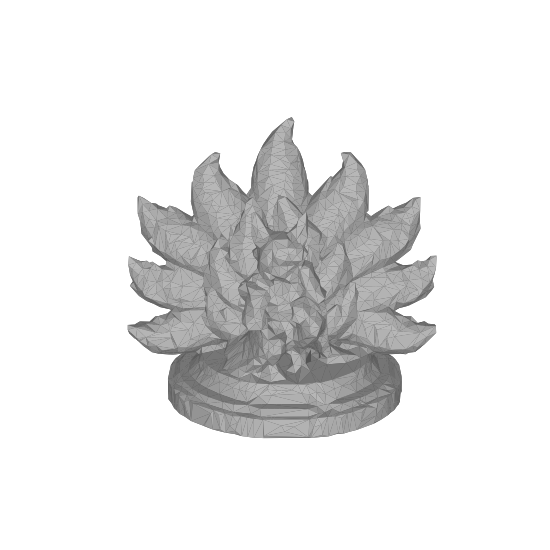

# PrintGuard

面向 FDM 打印件的 **"生成 → 可制造性校核 → 修复 → 交付"** MCP 能力包。
Lux3D 生成模型 + 确定性几何工具链（水密/悬垂/壁厚检测，体素重构/增厚/自动摆向），
交付可直接切片的 3MF、诊断报告图（缺陷着色+中文指标）与旋转预览 GIF。

## 交付示例

九尾狐手办（anime / G1-Turbo / 130mm，fast 档端到端 ~2min）：风险 D→S，水密，悬垂 16%→5%。
诊断图左=缺陷着色 3D（灰=正常 · 蓝=贴床 · 红=悬垂 · ◆=最薄壁），右=中文指标与修复步骤；GIF 为对话内旋转预览。




## 三步接入任意 Agent（MCP）

1. 安装 [uv](https://docs.astral.sh/uv/)（一次性）：
   ```powershell
   powershell -c "irm https://astral.sh/uv/install.ps1 | iex"
   ```
2. 在你的 Agent（Claude Desktop / Cursor / DSH…）配置里粘贴：
   ```json
   {
     "mcpServers": {
       "printguard": {
         "command": "uvx",
         "args": ["--from", "git+https://github.com/milu348/PrintGuard_Aholo", "printguard-mcp"],
         "env": { "AHOLO_API_KEY": "<你的 key；只做检测/修复可留空>" }
       }
     }
   }
   ```
   首次调用时 uv 自动拉取并安装，无需手动下载。
3. 对 Agent 说：**"帮我做一个能打印的手机支架，高 10 厘米"**。

> Key 免费申请：labs.aholo3d.cn。检测/修复已有模型完全不需要 key；只有生成新模型需要。
>
> 说明：stdio 形态仅限桌面宿主（本机运行时）；产物以本地绝对路径交付，诊断缩略图随工具结果内联返回，全程无需外部服务器。

## 两种质量档

| | `fast`（默认） | `fine` |
|---|---|---|
| 适用 | 结构件/支架 | **手办/细节件** |
| 配方 | G1-Turbo + 100k + 自适应 pitch | G1 + 300k + 0.3mm 细 pitch |
| 耗时 | ~2 分钟 | ~10 分钟 |

Agent 会按场景自动选择；交付物为 `printable.3mf + diagnostic_sheet.png + turntable.gif`。

## 本地开发

```powershell
python -m venv .venv
.venv\Scripts\python.exe -m pip install -e .
.venv\Scripts\python.exe printguard.py selftest   # 7 个检查用例
.venv\Scripts\python.exe pipeline.py "测试" --height-mm 100
.venv\Scripts\python.exe mcp_server.py            # MCP stdio
```

详见 `PrintGuard.md`（技术方案）与 `.dsh/skills/printguard/SKILL.md`（Agent 编排规约）。
